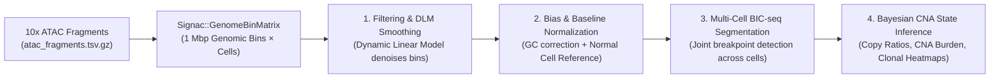

# ATAC-CNA (`AtaCNA` / `AtaCNV`) Overview & Implementation Guide for Ganglioglioma Multiome

**Date:** November 12, 2026  
**Project:** Ganglioglioma 10x Multiome Analysis  
**Method Reference:** Wang et al., *"Detecting copy-number alterations from single-cell chromatin sequencing data by AtaCNA"*, *Cell Reports Methods* (2024)  
**R Package / GitHub:** `AtaCNV` (`Aelita-Stone/AtaCNV` / `XiDsLab/AtaCNV`)  
**Target Pipeline Integration:** [`process_and_merge_atac.R`](file:///Users/franz/Documents/Code/Ganglioglioma/Multiome_workspace/process_and_merge_atac.R) & [`test_process_and_merge_atac.Rmd`](file:///Users/franz/Documents/Code/Ganglioglioma/Multiome_workspace/test_process_and_merge_atac.Rmd)  

---

## 1. What is ATAC-CNA (`AtaCNA`)?

**AtaCNA** (distributed as the R package **`AtaCNV`**) is a statistical and Bayesian framework designed to infer genome-wide **somatic Copy Number Alterations (CNAs / CNVs)** at single-cell resolution directly from **scATAC-seq** (or the ATAC modality of **10x Multiome**) data.

### Why Use ATAC-CNA Instead of RNA-Based CNV Callers (like InferCNV or CopyKAT)?
In 10x Multiome datasets, inferring CNAs from the ATAC modality offers a major biological advantage over scRNA-seq:
1. **Direct DNA Sampling Across the Whole Genome:** scRNA-seq only samples expressed genes, which are heavily confounded by cell-type-specific transcriptional programs (e.g., neuronal vs. glial gene clusters on the same chromosome can mimic false amplifications/deletions). scATAC-seq samples transposase-accessible **DNA fragments across both coding and non-coding intergenic regions**, providing uniform genome-wide tiling (e.g., 1 Mbp bins).
2. **Distinguishing Neoplastic vs. Normal Cells in Ganglioglioma:** Gangliogliomas can harbor recurrent chromosomal gains/losses (such as chromosome 7 gain encompassing *BRAF*, or chr 5, 7, 12gains / chr 9p, 10, 22q losses in glioneuronal tumors) alongside subtle subclonal architecture. Combining ATAC-derived CNA profiles with RNA expression provides an orthogonal molecular filter to separate **neoplastic glioneuronal cells** from **reactive normal astrocytes, normal cortical neurons, and infiltrating immune cells**.

---

## 2. How Does `AtaCNA` Work? (Step-by-Step Algorithm)

Because single-cell ATAC-seq data are sparse and affected by local chromatin accessibility and GC-content bias, `AtaCNA` applies a 4-stage mathematical pipeline:



1. **Genomic Binning & Preprocessing:**
   - Rather than using narrow MACS2 peaks (which reflect regulatory TF binding rather than DNA copy number), the genome (`hg38`) is partitioned into contiguous **1 Mbp non-overlapping genomic windows** (~3,000 bins across `chr1`–`chr22`).
   - Bins with extreme mappability issues, ENCODE blacklist overlap, or excessive zeros are filtered out.
2. **Dynamic Linear Model (DLM) Smoothing & GC Correction (`AtaCNV::normalize`):**
   - Smooths out local regulatory accessibility spikes and single-cell dropout noise along each chromosome using a first-order Dynamic Linear Model (Kalman filter smoother).
   - Regresses out bin-level GC-content bias per cell (`gc_correction = TRUE`).
   - Normalizes each cell against a **diploid baseline** derived either from:
     - **Known normal reference cells** (`mode = "normal cells"` — e.g., Microglia, Endothelial cells, Oligodendrocytes from `Azimuth_cellType`, or cells from `GG001AC` Access Cortex), or
     - **De novo auto-detected normal cells** (`mode = "none"`) identified via preliminary hierarchical clustering.
3. **Joint Multi-Sample BIC-seq Segmentation (`AtaCNV::calculate_CNV`):**
   - Adapts the Bayesian Information Criterion segmentation algorithm (BIC-seq) across all cells simultaneously to detect shared chromosomal breakpoints (penalty parameter `lambda`).
4. **Copy Ratio Estimation, CNA Burden & Subclone Classification:**
   - Outputs continuous copy-number ratios ($\text{Copy Ratio} \approx 1.0$ for diploid $2N$, $> 1.0$ for amplification, $< 1.0$ for deletion), discrete copy states, and a per-cell **CNA Burden Score** to classify malignant vs. non-malignant cells and resolve tumor subclones.

---

## 3. Inputs and Outputs of `AtaCNA`

### Input Data Required
| Input Component | Format / Data Type | Where It Comes From in Our Pipeline |
| :--- | :--- | :--- |
| **1. Cell-by-Bin Count Matrix (`count`)** | Sparse or dense numeric matrix (`dgCMatrix` or `matrix`), where **rows = 1 Mbp genomic bins** (`chr1-1-1000000`) and **columns = cell barcodes**. | Generated directly from our `multiome_obj[["ATAC"]]` `Fragment` object (`atac_fragments.tsv.gz`) using `Signac::GenomeBinMatrix()` restricted to post-QC `colnames(multiome_obj)`. |
| **2. Reference Genome (`genome`)** | Character string: `"hg38"` (or `"hg19"`). | `"hg38"` (matches our `EnsDb.Hsapiens.v86` / UCSC setup in [`process_and_merge_atac.R`](file:///Users/franz/Documents/Code/Ganglioglioma/Multiome_workspace/process_and_merge_atac.R)). |
| **3. Normal Cell Baseline (`normal_cells`)** | *(Optional but recommended)* Logical vector (`TRUE`/`FALSE`) or character vector of cell barcodes known to be non-neoplastic diploid cells. | Directly extracted from `multiome_obj$Azimuth_cellType` (e.g., `Micro-PVM`, `Endo`, `VLMC`, `Oligo`) or from our matched normal region sample (`GG001AC`). |

---

### Output Data Produced
| Output Object / File | Description | How We Use It in Seurat (`multiome_obj`) |
| :--- | :--- | :--- |
| **`norm_re.rds` (`norm_re$norm_count`, `norm_re$baseline`)** | Smoothed, GC-corrected, and baseline-normalized bin-by-cell matrix and diploid reference profile. | Intermediate input for segmentation and quality inspection. |
| **`CNV_re.rds` (`seg_re$copy_ratio` / `cnv_matrix`)** | Segmented **Bin-by-Cell Copy Ratio Matrix** (centered at $1.0$ for diploid $2N$) and discrete copy-number state matrix. | Stored as a new Seurat assay (`multiome_obj[["CNA"]] <- CreateAssayObject(data = seg_re$copy_ratio)`) to visualize specific chromosomal gains/losses (e.g., `chr7` gain) on `wnn.umap`. |
| **Per-Cell `CNA_burden` & `CNA_cell_class`** | Per-cell genome-wide CNA burden score ($\sum |\text{Copy Ratio} - 1|$) and classification (`Malignant` vs. `Normal` + `CNA_subclone`). | Added directly to `multiome_obj@meta.data$CNA_burden` and `multiome_obj@meta.data$CNA_clone` for UMAP plotting and downstream DE/trajectory filtering. |
| **Genome-Wide CNA Heatmap (`ComplexHeatmap`)** | Publication-ready hierarchical clustering heatmap of all cells (rows) across chromosomes `chr1`–`chr22` (columns), annotated by `Azimuth_cellType` and sample region (`TB`, `IF`, `AMY`, `AC`). | Exported as `<sample_id>_atac_cna_heatmap.pdf` in `output_dir`. |

---

## 4. How to Implement `AtaCNA` in Our Ganglioglioma Pipeline

### Step 1: Install `AtaCNV` on the Cluster R Environment
Run the following once in an interactive R session on the cluster:

```r
if (!requireNamespace("BiocManager", quietly = TRUE)) install.packages("BiocManager")
BiocManager::install(c("edgeR", "ComplexHeatmap", "GenomicRanges", "BSgenome.Hsapiens.UCSC.hg38"))

if (!requireNamespace("devtools", quietly = TRUE)) install.packages("devtools")
devtools::install_github("Aelita-Stone/AtaCNV")
```

---

### Step 2: Code Chunk to Add to [`test_process_and_merge_atac.Rmd`](file:///Users/franz/Documents/Code/Ganglioglioma/Multiome_workspace/test_process_and_merge_atac.Rmd) (or [`process_and_merge_atac.R`](file:///Users/franz/Documents/Code/Ganglioglioma/Multiome_workspace/process_and_merge_atac.R))

Because `multiome_obj` already contains the validated post-QC cells, the attached `Fragment` object, and `Azimuth_cellType` annotations, we can add a modular step right after **Chunk 11 (Joint WNN Dimensionality Reduction)**:

```r
# ==============================================================================
# Step: Single-Cell ATAC Copy Number Alteration (CNA) Inference via AtaCNA
# ==============================================================================
library(AtaCNV)
library(BSgenome.Hsapiens.UCSC.hg38)
library(ComplexHeatmap)

cna_out_dir <- file.path(output_dir, "AtaCNA")
dir.create(cna_out_dir, showWarnings = FALSE, recursive = TRUE)

# ------------------------------------------------------------------------------
# 1. Build 1 Mbp Genome-Wide Tile Matrix from the ATAC Fragment Object
# ------------------------------------------------------------------------------
DefaultAssay(multiome_obj) <- "ATAC"

# Keep standard autosomes (chr1 - chr22) for somatic CNA calling
chrom_sizes <- seqlengths(BSgenome.Hsapiens.UCSC.hg38)[paste0("chr", 1:22)]

cat("Quantifying 1 Mbp genomic bins across chr1-chr22 for post-QC cells...\n")
bin_matrix <- Signac::GenomeBinMatrix(
  fragments = Fragments(multiome_obj),
  genome    = chrom_sizes,
  cells     = colnames(multiome_obj),
  binsize   = 1000000, # 1 Mbp windows required by AtaCNA
  verbose   = TRUE
)

# Remove blacklist-overlapping 1 Mbp bins
bin_gr <- Signac::StringToGRanges(rownames(bin_matrix), sep = c(":", "-"))
keep_bins <- !overlapsAny(bin_gr, blacklist_hg38_unified)
bin_matrix <- bin_matrix[keep_bins, ]

# Standardize bin names to "chr1_1_1000000" if required by AtaCNV parser
rownames(bin_matrix) <- gsub("[:\\-]", "_", rownames(bin_matrix))

# ------------------------------------------------------------------------------
# 2. Define Reference Diploid Normal Cells from Azimuth Annotations
# ------------------------------------------------------------------------------
# Non-neoplastic microenvironment populations (immune, vascular, mature oligos)
# serve as internal diploid controls
normal_types <- c("Micro-PVM", "Microglia", "Endo", "Endothelial", "VLMC", "Pericyte", "Oligo", "Oligodendrocyte")
is_normal_cell <- multiome_obj$Azimuth_cellType %in% normal_types

cat(sprintf("Identified %d internal reference diploid cells (%s)\n",
            sum(is_normal_cell), paste(intersect(normal_types, unique(multiome_obj$Azimuth_cellType)), collapse = ", ")))

# Fallback to unsupervised baseline ("none") if fewer than 30 reference normal cells exist
cna_mode <- if (sum(is_normal_cell) >= 30) "normal cells" else "none"

# ------------------------------------------------------------------------------
# 3. Run AtaCNA Normalization (DLM Smoothing + GC Correction)
# ------------------------------------------------------------------------------
norm_re <- AtaCNV::normalize(
  count         = as.matrix(bin_matrix),
  genome        = "hg38",
  mode          = cna_mode,
  normal_cells  = if (cna_mode == "normal cells") is_normal_cell else NULL,
  output_dir    = paste0(cna_out_dir, "/"),
  output_name   = paste0(sample_id, "_norm_re.rds"),
  gc_correction = TRUE
)

# ------------------------------------------------------------------------------
# 4. Run Multi-Sample BIC-seq Segmentation & Copy Ratio Estimation
# ------------------------------------------------------------------------------
seg_re <- AtaCNV::calculate_CNV(
  norm_count  = norm_re$norm_count,
  baseline    = norm_re$baseline,
  output_dir  = paste0(cna_out_dir, "/"),
  output_name = paste0(sample_id, "_CNV_re.rds")
)

# ------------------------------------------------------------------------------
# 5. Attach CNA Burden & Copy Ratios Back into Seurat multiome_obj
# ------------------------------------------------------------------------------
# Extract segmented copy ratio matrix (bins x cells, diploid = 1.0)
copy_ratio_mat <- if ("copy_ratio" %in% names(seg_re)) seg_re$copy_ratio else seg_re[[1]]

# Align cell order with multiome_obj
shared_cna_cells <- intersect(colnames(multiome_obj), colnames(copy_ratio_mat))
multiome_obj$CNA_burden <- NA_real_

# Compute genome-wide CNA burden = mean absolute deviation from diploid (1.0)
cna_burden <- colMeans(abs(copy_ratio_mat[, shared_cna_cells, drop = FALSE] - 1.0), na.rm = TRUE)
multiome_obj@meta.data[shared_cna_cells, "CNA_burden"] <- cna_burden

# Store segmented 1 Mbp Copy Ratios as a dedicated "CNA" Assay in multiome_obj
multiome_obj[["CNA"]] <- CreateAssayObject(counts = copy_ratio_mat[, colnames(multiome_obj), drop = FALSE])

# Plot CNA Burden on the Joint WNN UMAP
p_cna_umap <- FeaturePlot(
  multiome_obj,
  features  = "CNA_burden",
  reduction = "wnn.umap",
  cols      = c("lightgrey", "orange", "firebrick")
) + ggtitle(paste0(sample_id, " - Single-Cell ATAC CNA Burden"))

ggsave(
  filename = file.path(output_dir, paste0(sample_id, "_atac_cna_umap.pdf")),
  plot     = p_cna_umap,
  width    = 7,
  height   = 6
)
```

---

## 5. Recommended Strategy for Our 4-Sample Patient Cohort (`GG001`)

Because our four samples (`GG001TB` Tumor Bulk, `GG001AMY` Amygdala, `GG001IF` Interface, `GG001AC` Access Cortex) come from **the same patient (`GG001`)**, running `AtaCNA` across all 4 samples together is especially powerful:
1. **Shared Diploid Patient Baseline:** Non-neoplastic cells from `GG001AC` (Access Cortex) and immune/vascular cells (`Micro-PVM`, `Endo`) from all 4 regions share the exact same germline genome, eliminating inter-patient germline CNV polymorphism noise.
2. **Spatial Clonality Tracking (`TB -> IF -> AC`):** By joint-segmenting `TB`, `IF`, `AMY`, and `AC` together in `AtaCNV::calculate_CNV()`, you can directly track whether rare cells at the epileptogenic **Interface (`GG001IF`)** carry the same clonal somatic copy-number alterations as the **Tumor Bulk (`GG001TB`)**.

