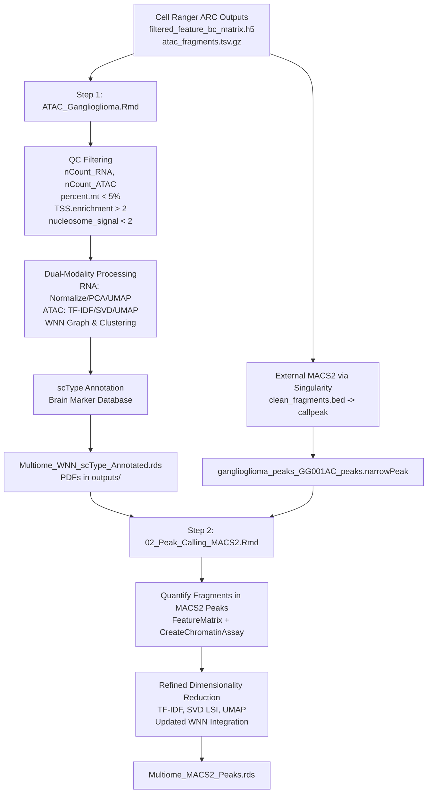

# Ganglioglioma 10x Multiome Analysis Pipeline

This repository contains the single-cell multiomic analysis pipeline (joint single-nucleus RNA-seq and single-nucleus ATAC-seq) for Ganglioglioma samples (`GG001AC`), built with **Seurat v4/v5** and **Signac**.

The pipeline integrates gene expression and chromatin accessibility, provides cell-type annotation using **scType**, refines regulatory regions using external **MACS2** peak calling, and supports downstream multimodal analyses.

---

## Pipeline Overview & Workflow



---

## File Registry & Module Implementation

### 1. `ATAC_Ganglioglioma.Rmd` (Step 1: Initial QC, Integration & Annotation)
* **Assigned Object:** `ATAC_gang`
* **Inputs:**
  * Count matrix: `/data-pure/sequencing/ngs/NGS2026_10893/HG38/count/cellranger/GG001AC/filtered_feature_bc_matrix.h5`
  * Fragment file: `/data-pure/sequencing/ngs/NGS2026_10893/HG38/count/cellranger/GG001AC/atac_fragments.tsv.gz`
  * Genome annotations: `EnsDb.Hsapiens.v86` (converted to UCSC / `hg38` coordinates).
* **Key Steps Implemented:**
  1. **Dual Assay Initialization:** Loads RNA counts matrix (`CreateSeuratObject`) and adds the ATAC count matrix as a `ChromatinAssay`.
  2. **ATAC & RNA QC Metrics:**
     - Computes mitochondrial percentage (`percent.mt`, thresholded at `< 5%` for single nuclei).
     - Computes ATAC signal quality: `NucleosomeSignal()` (calibrated filter `< 4`) and `TSSEnrichment(fast = FALSE)`.
     - Single-cell ATAC noise ratios: `pct_reads_in_peaks` (FRiP) and `blacklist_ratio` (ENCODE blacklist fraction `< 0.05`).
     - Empirical TSS enrichment assessment (density and depth correlation saved to `outputs/TSS_enrichment_distribution.pdf` with 2, 3, 4 reference cutoffs).
     - Quality filtering: `nCount_RNA` (500–25,000), `nCount_ATAC` (4,000–70,000), `percent.mt < 5%`, `TSS.enrichment > 2`, `nucleosome_signal < 4`, `blacklist_ratio < 0.05`.
  3. **Modality Preprocessing:**
     - RNA: Standard log-normalization, variable feature selection, scaling, PCA, and RNA UMAP (`umap.rna`).
     - ATAC: TF-IDF normalization, top feature selection (`q0`), SVD/LSI dimension reduction, and ATAC UMAP (`umap.atac`, dims 2:50).
  4. **Multimodal WNN Clustering:**
     - Weighted Nearest Neighbors (`FindMultiModalNeighbors`) combining RNA PCA (dims 1:50) and ATAC LSI (dims 2:50).
     - Joint clustering (`FindClusters(graph.name = "wsnn", algorithm = 3)` - SLM algorithm).
     - Joint WNN UMAP embedding (`wnn.umap`).
  5. **Automated Cell-Type Annotation & Gene Activity Validation:**
     - scType annotation loaded from GitHub wrapper and curated Brain marker set (`ScTypeDB_short.xlsx`).
     - Identifies astrocytes, neurons, oligodendrocytes, immune/microglia, OPCs, etc., saved in `sctype_classification`.
     - Derives `GeneActivity` assay from chromatin accessibility; generates dual RNA vs GeneActivity feature plots to confirm concordance of marker genes (*GFAP*, *MBP*, *RBFOX3*, *SOX2*, *AIF1*).
  6. **Exports:**
     - Saves high-resolution multi-panel UMAP plots to `outputs/UMAP_initial_clusters.pdf` and `outputs/UMAP_scType_annotated.pdf`.
     - Exports processed Seurat object as `Multiome_WNN_scType_Annotated.rds`.

---

### 2. `02_Peak_Calling_MACS2.Rmd` (Step 2: External MACS2 Import & Assay Refinement)
* **Assigned Object:** `ATAC_gang`
* **Inputs:**
  * Preprocessed object: `Multiome_WNN_scType_Annotated.rds`
  * MACS2 peak calls: `/data-pure/workspace/fdervis/Ganglioglioma/Multiome/MACS2_peakCalling/ganglioglioma_peaks_GG001AC_peaks.narrowPeak`
* **Cluster Pre-processing (Singularity):**
  ```bash
  # Remove comment lines from fragment file:
  zgrep -v "^#" /path/to/fragments.tsv.gz > /data-pure/workspace/fdervis/Ganglioglioma/Multiome/MACS2_peakCalling/clean_fragments.bed

  # Call high-sensitivity peaks via MACS2:
  run_singularity.sh macs2_macs3.sif macs2 callpeak \
    -t /data-pure/workspace/fdervis/Ganglioglioma/Multiome/MACS2_peakCalling/clean_fragments.bed \
    -f BED --nomodel --shift -75 --extsize 150 \
    --outdir /data-pure/workspace/fdervis/Ganglioglioma/Multiome/MACS2_peakCalling \
    -n ganglioglioma_peaks_GG001AC -g hs
  ```
* **Key Steps Implemented:**
  1. **Peak Filtering & Summit Standardization:**
     - Reads `.narrowPeak` into R; filters statistical significance at $q \le 0.01$ (`neg_log10qvalue >= 2`).
     - **Corces et al. (2018) 501 bp Fixed-Width Standardization:** Re-centers each peak on its exact summit (`start + relative_summit_pos + 1`) and resizes to 501 bp ($\pm 250\text{ bp}$).
     - Performs greedy iterative overlap removal to keep the most significant non-redundant summit when windows overlap.
     - Filters non-standard contigs (`keepStandardChromosomes(pruning.mode = "coarse")`) and removes ENCODE artefactual regions (`blacklist_hg38_unified`).
  2. **Fragment Re-quantification:**
     - Quantifies raw ATAC fragments across cells for the standardized 501 bp MACS2 peaks via `FeatureMatrix()`.
     - Reconstructs a clean `ChromatinAssay` and replaces `ATAC_gang[["ATAC"]]`.
  3. **Dimensionality Reduction & WNN Recomputation:**
     - Runs `RunTFIDF()`, `FindTopFeatures(min.cutoff = "q0")`, and `RunSVD()`.
     - Generates refined ATAC UMAP (`umap.atac.macs2`) and recomputed WNN integration (`wnn.umap.macs2`).
  4. **Exports:**
     - Saves updated Seurat object as `Multiome_MACS2_Peaks.rds`.

---

### 3. Documentation & Tracking Files
* **`SKILLS_BREAKDOWN_AND_RECOMMENDATIONS.md`**: Full technical synthesis of newly added ATAC skills suite, comparing existing practices and explaining rationales for fixes.
* **`TODO.md`**: Project roadmap tracking upcoming scripts (03: TF Motifs/chromVAR, 04: Enhancer-Gene Linking, 05: Pseudobulk DARs) and future cluster pseudobulk peak calling.
* **`CHANGELOG.md`**: Chronological log of all repository modifications.
* **`01_QC_and_setup.R`**: Standalone testing script (untracked in Git).

---

## Cluster & Git Operating Guidelines

1. **Development & Push (Local IDE):**
   - Code edits are made locally and tracked via git.
   - Pushes update the remote repository: `git push origin main`.
2. **Execution & Pull (Cluster / RStudio Server):**
   - In the cluster repository root (`Multiome/`):
     ```bash
     git pull
     ```
   - If local modifications on the cluster conflict with pull:
     ```bash
     git restore <filename> && git pull    # to discard cluster changes
     # or
     git stash && git pull                 # to stash cluster changes
     ```
3. **Cluster SSH Authentication:**
   - Authenticated using Ed25519 key (`~/.ssh/id_ed25519` or `~/.ssh/config` entry) added to GitHub account.

---

## Git Push & Change Log

| Commit | Date | Files Modified | Description of Changes |
| :--- | :--- | :--- | :--- |
| `8ff65bb` | 2026-10-08 | `.gitignore` | Initial repository structure and gitignore configuration. |
| `de26b7a` | 2026-10-08 | `ATAC_Ganglioglioma.Rmd`, `.gitignore` | Added ATAC QC metrics (`NucleosomeSignal`, `TSSEnrichment`), standard chromosome filtering, and updated gitignore whitelist. |
| `13385e1` | 2026-10-08 | `ATAC_Ganglioglioma.Rmd`, `02_Peak_Calling_MACS2.Rmd` | Added RDS saving to step 1 and created initial MACS2 peak calling script. |
| `7ea4b91` | 2026-10-08 | `ATAC_Ganglioglioma.Rmd` | Added automatic PDF export of initial and scType-annotated UMAPs to `outputs/` directory. |
| `23b98ea` | 2026-10-12 | `ATAC_Ganglioglioma.Rmd`, `02_Peak_Calling_MACS2.Rmd` | Renamed Seurat object variable from generic `pbmc` to project-specific `ATAC_gang` across all scripts. |
| `e800be4` | 2026-10-12 | `02_Peak_Calling_MACS2.Rmd` | Updated MACS2 pipeline to import external Singularity `.narrowPeak` outputs, quantify fragment counts into new `ChromatinAssay`, and recompute dimensionality reductions. |
| `c4d16f0` | 2026-10-12 | `README.md` | Added comprehensive pipeline documentation, architecture diagrams, file registry, and structured push changelog. |
| `59be756` | 2026-10-12 | `02_Peak_Calling_MACS2.Rmd`, `README.md` | Fixed `Fragments()` generic error by explicitly targeting `ATAC_gang[["ATAC"]]` and setting `DefaultAssay` to ATAC (preventing method dispatch failure against Seurat v5 Assay5). |
| `e9e06f6` | 2026-10-13 | `ATAC_Ganglioglioma.Rmd`, `02_Peak_Calling_MACS2.Rmd`, `SKILLS_BREAKDOWN_AND_RECOMMENDATIONS.md`, `TODO.md`, `CHANGELOG.md`, `README.md` | Calibrated QC thresholds (`nucleosome_signal < 4`), added TSS enrichment distribution exploration, FRiP/blacklist ratios, GeneActivity matrix, 501 bp summit-centered peak standardization (Corces 2018), and project roadmap. |

> **Agent Protocol:** Before every future `git push`, this README's **Git Push & Change Log** and **File Registry** must be updated with the newest modifications.
